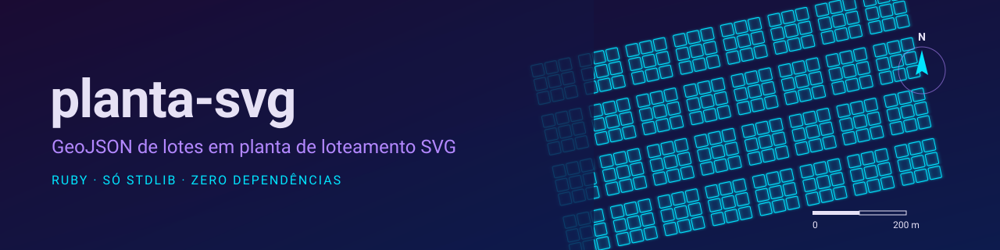
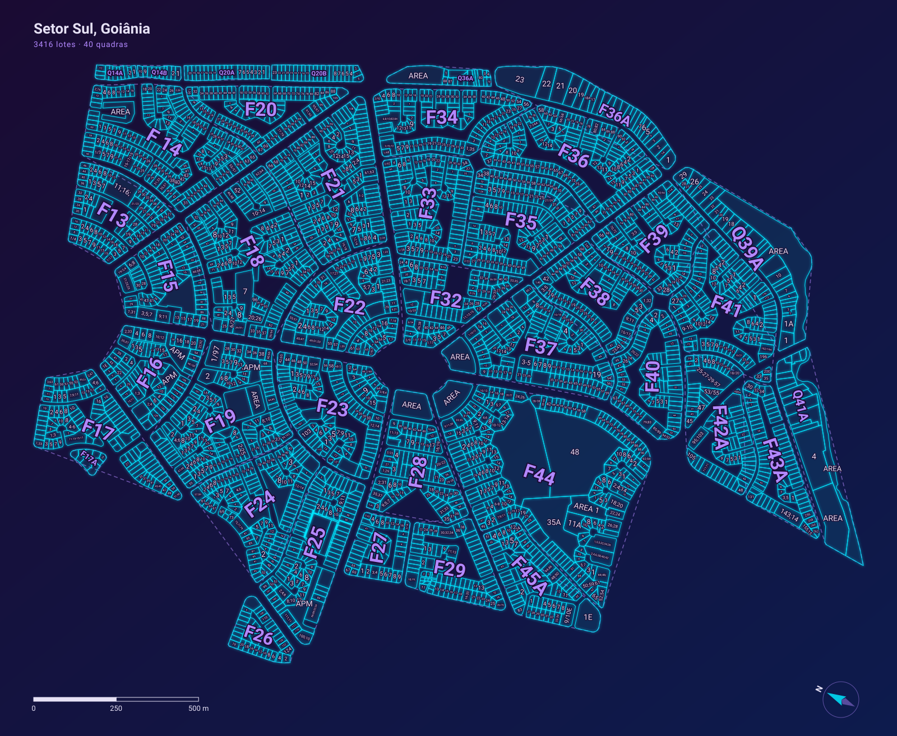
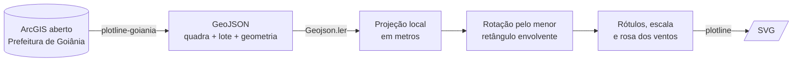

<p align="center"></p>

[](https://github.com/Dimasaas/plotline/actions/workflows/ci.yml)


# Plotline

**planta de loteamento em SVG a partir de GeoJSON**

Converte um GeoJSON de lotes em uma planta de loteamento em SVG, com projeção em metros, rotação automática, rótulos, barra de escala e rosa dos ventos. Ruby, só a stdlib.

<p align="center"></p>

<sub>Demo: Setor Sul, Goiânia (3.416 lotes em 40 quadras), geometria do ArcGIS aberto da Prefeitura. Gerada com `bin/plotline-goiania "Setor Sul"` e `bin/plotline setor-sul.geojson --titulo "Setor Sul, Goiânia"`.</sub>

## Por que existe

Plantas de loteamento costumam morrer em PDF ou em ferramentas de CAD que não rodam em servidor. Eu precisava de uma planta que fosse só texto: gerada por script, versionável, leve para a web e legível em qualquer tela. Este projeto faz o caminho curto, de coordenadas geográficas a um SVG pronto para publicar, sem gem nenhuma.

## Como funciona



## Uso

Sem dependências: basta ter Ruby 3.2 ou mais novo.

```sh
git clone https://github.com/Dimasaas/plotline && cd plotline

# 1) buscar a geometria de um bairro (grava setor-sul.geojson)
bin/plotline-goiania "Setor Sul"

# 2) desenhar
bin/plotline setor-sul.geojson --titulo "Setor Sul, Goiânia" > planta.svg
```

### `bin/plotline entrada.geojson > saida.svg`

Aceita `FeatureCollection`, `Feature` ou geometria solta (`Polygon`, `MultiPolygon`). Cada feição pode trazer `quadra` e `lote` nas propriedades (também entende `qd`/`lt` e `nm_qdr`/`nm_lot`). Use `-` para ler da entrada padrão.

| opção | efeito |
| --- | --- |
| `--titulo TEXTO` | título e contagem de lotes e quadras no topo |
| `--largura N` | largura do viewBox (padrão 1600) |
| `--giro GRAUS` | força o giro, anti-horário, em vez de escolher o melhor |
| `--sem-rotacao` | mantém o norte para cima |
| `--sem-rotulos` | sem números de lote nem de quadra |

### `bin/plotline-goiania "<bairro>"`

Busca no serviço aberto da Prefeitura de Goiânia (sem chave) o bairro, suas quadras e seus lotes, e grava um GeoJSON. O nome aceita "Setor Sul" ou só "Sul", sem diferenciar maiúsculas nem acentos; se o nome for ambíguo, lista os candidatos. Use `-o arquivo` para escolher a saída, ou `-o -` para escrever na tela.

**Só a geometria e os números de quadra e lote saem.** Os `outFields` pedidos ao servidor são nominais (`id_qdr,nm_lot`), e qualquer outro atributo que viesse na resposta (inscrição cadastral, por exemplo) é descartado antes de gravar. Áreas públicas, marcadas como quadra `AREA`, ficam de fora.

O serviço tem três camadas encadeadas, e o campo de ligação muda de nome entre elas:

| camada | o que é | chave |
| --- | --- | --- |
| 2 | divisas de bairro | `id` |
| 1 | divisas de quadra | `id_bai` (bairro), `id` (quadra) |
| 0 | divisas de lote | `id_qdr` (quadra) |

O ArcGIS responde HTTP 200 com `{"error": ...}` no corpo quando recusa uma consulta, então o cliente confere o corpo, não só o status. Também segue `exceededTransferLimit` para nunca ler menos lotes do que existem sem avisar.

## Decisões

**Por que corrigir por cos φ.** Um grau de latitude mede sempre cerca de 111,2 km, mas um grau de longitude encolhe com o cosseno da latitude. Em Goiânia (cerca de 16,7° S) o cosseno vale 0,958: tratar os dois graus como iguais alargaria todo lote em 4,4%. A projeção é equirretangular local, centrada na caixa dos próprios lotes, `x = Δlng · R · cos φ₀` e `y = Δlat · R`. Em um bairro (alguns quilômetros) a distorção residual é desprezível, e a conta continua sendo uma linha só.

**Como escolhe a rotação.** Para o retângulo de área mínima que envolve um conjunto de pontos, um dos lados coincide com uma aresta do casco convexo. Então basta calcular o casco, girar a planta alinhando cada aresta aos eixos e ficar com a menor área: o resultado é exato, sem varrer ângulos de grau em grau. Dois empates são resolvidos pensando em quem lê:

- girar 90° dá a mesma área, então fica a orientação em que o lado maior está na horizontal (planta "deitada");
- girar 180° também empata, então vale o ângulo de menor módulo, em (-90°, 90°], e o norte continua perto do topo.

**Rosa dos ventos e rótulos.** A rosa gira no sentido contrário ao da planta, no mesmo tanto. O número do lote vai no centroide do polígono e segue o lado maior do lote; se o lote é "em pé" e o número cabe melhor na horizontal, fica na horizontal. Números que cairiam debaixo do rótulo da quadra são omitidos, e lotes pequenos demais ficam sem número.

**Barra de escala.** O comprimento é o maior valor da série 1-2-5 (1, 2, 5, 10, 20, 50, 100…) que cabe em cerca de 22% da largura do terreno.

## Testes

```sh
rake test
```

63 testes, nenhum usa rede: a entrada é uma grade sintética de lotes gerada dentro do próprio teste (inclusive girada, para conferir que a rotação volta aos eixos) e o ArcGIS é simulado com respostas montadas à mão. A CI roda em Ruby 3.2 e 3.3.

## Licença

[PolyForm Noncommercial 1.0.0](LICENSE). Uso livre para estudo, pesquisa e projetos pessoais ou sem fins comerciais. O uso comercial só com autorização do autor.

---

## 🇺🇸 TL;DR

**Plotline** turns a GeoJSON file of land lots into an SVG subdivision plan, in pure Ruby with no gems. It projects degrees to local meters (equirectangular, with a cos φ correction for longitude), picks the rotation that gives the smallest bounding rectangle with the plan lying landscape (exact, by testing each convex hull edge), then draws lot and block labels at their centroids, a 1-2-5 scale bar and a north arrow that rotates with the plan. A second CLI, `plotline-goiania`, downloads lot geometry from the City of Goiânia's open ArcGIS service (no API key), keeping only geometry and block/lot numbers. Tests need no network. Licensed PolyForm Noncommercial 1.0.0.
